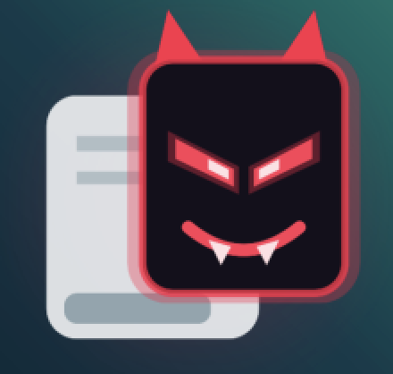

<p align="center">
  
</p>
<h1 align="center">Tapjacker NG</h1>


>[!warning]
>**For educational purposes, developers and authorized testers only.** 
> 
> Use this tool
> on apps you own or have explicit written permission to assess. Scanning or
> attacking apps without authorization may be illegal. You are responsible for
> how you use it.

A tapjacking proof-of-concept builder for Android 8.0 and newer.

This tool was built because every public tapjacking PoC out there was either a fixed
overlay hard-coded for one target, or had simply stopped working: Android 12 introduced the
untrusted-touch filter, Android 13 added runtime notification permission, Android 14 made
foreground services declare a type, and most repositories were never updated past Android 10.

This tool understands the current platform rules and lets you compose a
convincing overlay on the device in minutes.


## Install

1. Install the APK from the Releases page. Plug and Play. 
2. On first start the app requests "Display over other apps".
3. On Android 13+, grant notification access so the Stop action in the persistent notification is visible.

## Capabilities

### Overlay geometry

- **Full screen.** Covers the display including the status bar and navigation area (Android 12+;
  on 8 to 11 the system keeps the bars above app overlays).
- **Partial.** A rounded window with width, height, X, Y and corner radius sliders scaled to the
  device. Position is in dp from the top-left corner.
- Switch between the two at any time, including while the overlay is showing.

### Opacity

- Window alpha from 1.0 down to 0.1 in 0.05 steps, on every Android version.
- Applied on `WindowManager.LayoutParams.alpha`, which is what the platform's touch filter
  evaluates. View alpha does not count.
- The Opacity card reports the device's `maximumObscuringOpacityForTouch` and states the outcome
  for the current settings: within the limit taps reach the app underneath; above it the overlay
  is drawn at the requested alpha, including 1.0, but touches WILL NOT go through (see "Platform
  behaviour" below).
- On Android 8 to 11 there is no limit and the card says so.
- On Android 12+ a "System limit" section shows the live values of the two global settings behind
  the filter, whether the app is allowed to change them, and two buttons: "Lift limit to 1.0" and
  "Restore default". See "Lifting the limit".

### Touch handling

- **Pass-through on.** `FLAG_NOT_TOUCHABLE` is set and taps land on whatever is underneath. This
  is the tapjacking case.
- **Pass-through off.** The overlay captures taps. Long-press it to dismiss. Partial overlays can
  be dragged, and the position sliders in the app follow.

### Overlay content

- Background colour.
- Any number of elements of three kinds:
  - **Text**: content, colour, size, bold.
  - **Button**: label, fill, text colour, size, corner radius, drop shadow.
  - **Box**: fill, size, corner radius.
- Every element has an optional border (width and colour), padding, a nine-point anchor (corners,
  edges, centre) and an X/Y offset in dp.
- Colour picker with swatches, hex entry (`#RGB`, `#RRGGBB`, `#AARRGGBB`) and a per-element alpha
  slider.
- Reordering elements supported.

### Targets

Launched underneath the overlay when you press Start:

- Nothing, overlay only.
- Built-in test screen, which counts the taps that get through.
- Any installed app, from a searchable list.
- An explicit activity, entered as `package/.Activity`.

A delay before the overlay appears (0 to 10 s) and an auto-dismiss timer (0 to 5 min) complete the
run settings.

### Templates and presets

Nine pre-build templates: prize game, fake system dialog, permission prompt, consent banner,
captcha check etc.

Saving your own presets under a name and sharing the JSON with colleagues supported.


## Platform behaviour

### Android 12 and newer

- The untrusted-touch filter limits how opaque a pass-through overlay from another app may be.
  The limit is `InputManager.getMaximumObscuringOpacityForTouch()`, 0.8 on stock builds.
- A `FLAG_NOT_TOUCHABLE` overlay is drawn at that limit regardless of the alpha requested; a
  touchable overlay may be fully opaque. The app follows this rule: when you request more than
  the limit with pass-through on, it drops `FLAG_NOT_TOUCHABLE`, draws the overlay at the alpha
  you set and states that touches WILL NOT go through. Long-press the overlay to dismiss it in
  that state. Full opacity combined with pass-through requires the limit to be lifted (next
  section).
- If several pass-through overlays stack and their combined opacity exceeds the limit, the input
  dispatcher drops the touch.
- Touches that cross a pass-through overlay reach the target with `FLAG_WINDOW_IS_OBSCURED`.
  Views with `filterTouchesWhenObscured="true"` discard them. Activities that call
  `Window.setHideOverlayWindows(true)` hide the overlay entirely. These are the mitigations you
  are testing for.
- Overlays from the same app as the touched window are trusted, so the built-in test screen only
  proves geometry and pass-through. Use a real target to check obscured flags and mitigations.
- The overlay runs in a `specialUse` foreground service, as Android 14+ requires.

### Android 8 to 11

- No untrusted-touch filter. A pass-through overlay may be fully opaque and taps still land on
  the app underneath. The Opacity card says so and hides the limit section.
- `FLAG_WINDOW_IS_OBSCURED` and `filterTouchesWhenObscured` exist on these versions, so a target
  that uses them is still protected. Nothing else is.
- `Window.setHideOverlayWindows()` does not exist before Android 12; older targets cannot hide
  the overlay.
- `TYPE_APPLICATION_OVERLAY` windows sit below the status and navigation bars, so "Full screen"
  covers the app area only.

## Lifting the limit on Android 12+

The 0.8 cap is not hard-coded. It is a global system setting that both `WindowManager` and
`InputDispatcher` observe:

```
maximum_obscuring_opacity_for_touch   float, default 0.8
```

Set it to 1.0 and an Android 12+ device behaves like Android 11 for this purpose: pass-through
overlays are drawn at the requested alpha, including 1.0, and taps still reach the app
underneath. Verified on the API 37 emulator: with the setting at 1.0 a `FLAG_NOT_TOUCHABLE`
overlay at alpha 1.0 was rendered solid and every tap reached the activity below. The change
applies immediately without a reboot, persists across reboots until removed, and is device-wide,
so restore it when the test is over.

Two ways to set it:

**1. adb, no root required.** The shell user may write global settings on every build, so this
works on a stock, locked device with USB debugging enabled:

```
adb shell settings put global maximum_obscuring_opacity_for_touch 1.0
```

**2. From inside the app, after a one-time adb grant.** `WRITE_SECURE_SETTINGS` is a development
permission, so adb can grant it to the app once. The "Lift limit to 1.0" and "Restore default"
buttons then work on their own, including on a device that is no longer connected.

>[!note]
>Restore the stock value with:
>
>```
>adb shell settings delete global maximum_obscuring_opacity_for_touch
>```
>
>or the "Restore default" button.

>[!Note]
>None of this affects `FLAG_WINDOW_IS_OBSCURED`, `filterTouchesWhenObscured` or
>`setHideOverlayWindows()`. Those are the target's own mitigations and keep working, which is
>exactly what makes the lifted-limit run a fair test of them.
